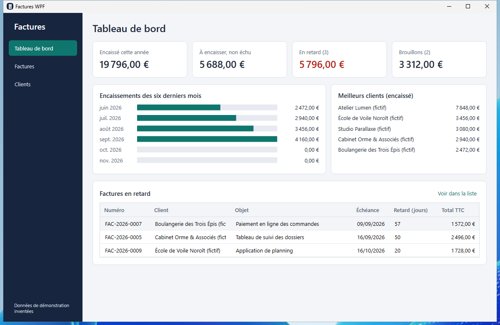
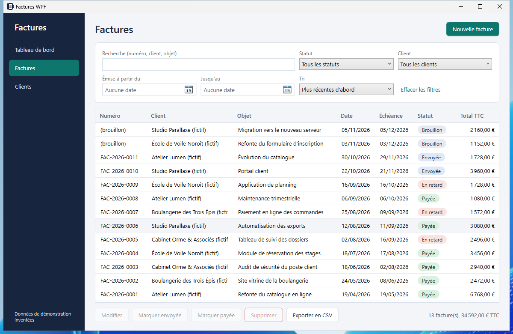
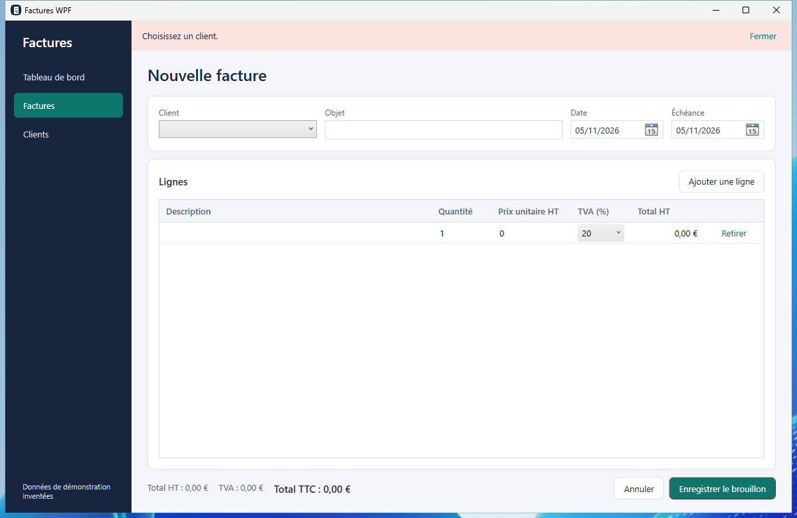

# factures-wpf

[](https://github.com/KorayAkyk/factures-wpf/actions/workflows/ci.yml)

Logiciel de bureau Windows de suivi de factures pour un travailleur indépendant, écrit en C# / .NET 10 / WPF.
Projet de démonstration : toutes les données sont inventées.

*English summary at the end of this page.*

## Ce que fait le logiciel

- **Clients** : création, modification, suppression (refusée si le client a des factures), délai de paiement par client.
- **Factures** : lignes avec quantité, prix et TVA, totaux recalculés à la saisie, échéance proposée selon le client.
- **Statuts** : brouillon, envoyée, payée, en retard. Le retard n'est pas stocké : il se déduit de la date du jour.
  Le numéro définitif (`FAC-2026-0001`) n'est attribué qu'à l'envoi, et une facture envoyée n'est plus modifiable.
- **Tableau de bord** : encaissé sur l'année, à encaisser, retards et leur ancienneté, encaissements des six derniers
  mois, meilleurs clients.
- **Recherche et filtres** : texte libre sans tenir compte de la casse ni des accents, statut, client, période, tri.
- **Export CSV** : ce qui est affiché, lisible par Excel en français, protégé contre l'injection de formules.
- **Base SQLite locale** : `%LOCALAPPDATA%\FacturesWpf\factures.db`, remplie à la première ouverture avec des données
  de démonstration.
- **Erreurs** : toute erreur s'affiche dans un bandeau de la fenêtre, avec un message en français.

## Capture

Captures réelles de l'application publiée, prises par la CI sur `windows-latest` (`build/ui-smoke.ps1`).







## Architecture

```text
              +---------------------------------------------+
              | Factures.App (net10.0-windows)              |
              | Vues XAML, styles, injection de dependances |
              +----------+-----------------------+----------+
                         |                       |
                         v                       v
   +-------------------------------+   +-------------------------------+
   | Factures.Presentation net10.0 |   | Factures.Data net10.0         |
   | ViewModels, navigation,       |   | SQLite : migrations et depots |
   | interfaces de dialogue        |   | (Microsoft.Data.Sqlite)       |
   +---------------+---------------+   +---------------+---------------+
                   |                                   |
                   v                                   v
              +---------------------------------------------+
              | Factures.Core (net10.0), sans dependance    |
              | Domaine, cas d'usage, LINQ, tableau de bord,|
              | export CSV, interfaces de stockage          |
              +---------------------------------------------+

   tests/Factures.Tests (net10.0)             metier, SQLite, ViewModels
   tests/Factures.App.Tests (net10.0-windows) vues XAML chargees et rendues
   installer/Factures.Installer (WiX 5)       MSI x64 du dossier publie
   build/Package.proj (MSBuild)               publication, MSI, paquet NuGet
```

Les dépendances vont toujours vers `Factures.Core`. `Factures.App` est le seul projet qui connaît à la fois les
interfaces et leurs implémentations (`Bootstrapper.cs`).

## Où trouver chaque compétence

| Compétence | Où la voir |
|---|---|
| C# | C# 14 avec références nullables activées et avertissements traités comme erreurs |
| .NET | .NET 10 (LTS), solution en couches, `net10.0` et `net10.0-windows` |
| WPF | `src/Factures.App` : fenêtre, `DataGrid`, gabarits, déclencheurs de style |
| MVVM | `src/Factures.Presentation` : CommunityToolkit.Mvvm ; les code-behind des vues se limitent à `InitializeComponent` |
| XAML | `src/Factures.App/Themes` : couleurs, boutons, grilles et badges en ressources communes |
| LINQ | `src/Factures.Core/Queries/InvoiceQueries.cs`, `src/Factures.Core/Reports/DashboardCalculator.cs` |
| WiX | `installer/Factures.Installer` : MSI WiX 5, raccourci, mise à niveau, interface en français |
| MSBuild | `build/Package.proj`, `Directory.Build.props`, cible de contrôle dans le `.wixproj` |
| NuGet | `Directory.Packages.props` (versions centralisées), `FacturesWpf.Core` empaqueté par la CI |

## Choix techniques et pourquoi

- **ViewModels dans une bibliothèque `net10.0`.** Elle ne peut pas référencer WPF : c'est le compilateur qui garantit la
  séparation, et les tests des ViewModels n'ont pas besoin de Windows.
- **Retard calculé, jamais stocké.** Une facture ne peut pas rester « envoyée » à tort : le statut dépend de la date
  fournie par `IClock`, que les tests fixent.
- **Numéro attribué à l'envoi.** Un brouillon supprimé ne laisse pas de trou dans la numérotation.
- **`Microsoft.Data.Sqlite` et SQL écrit à la main.** Trois tables ne justifient pas un ORM. Les montants sont stockés en
  texte décimal, car SQLite n'a pas de type décimal et un `REAL` les arrondirait.
- **Écriture transactionnelle.** Une facture et ses lignes sont enregistrées ensemble ou pas du tout. Un test le vérifie.
- **Navigation par `DataTemplate`.** La page courante est un ViewModel, la vue suit. Pas de framework de navigation.
- **Publication autonome.** Le MSI contient le runtime .NET : rien à installer d'autre, au prix d'un fichier plus gros.
- **Versions épinglées.** Paquets dans `Directory.Packages.props`, SDK dans `global.json`, actions GitHub par empreinte
  de commit.

## Compiler, tester, installer

Il faut Windows et le SDK .NET 10 indiqué dans `global.json`.

```powershell
dotnet restore FacturesWpf.sln
dotnet build FacturesWpf.sln -c Release
dotnet run --project src/Factures.App -c Release

dotnet test tests/Factures.Tests -c Release       # metier, SQLite, ViewModels
dotnet test tests/Factures.App.Tests -c Release   # vues WPF

dotnet msbuild build/Package.proj                 # artifacts/publish, artifacts/msi, artifacts/nuget
```

La CI exécute ces mêmes commandes.

Pour installer sans compiler : ouvrir une
[exécution de la CI](https://github.com/KorayAkyk/factures-wpf/actions/workflows/ci.yml), télécharger l'artefact
`FacturesWpf-msi`, puis lancer le fichier `.msi`. Le MSI n'est pas signé : Windows affiche un avertissement.
Le fichier fait environ 53 Mo. La désinstallation laisse la base de données en place dans
`%LOCALAPPDATA%\FacturesWpf`.

## Ce qui est vérifié, et comment

Chaque exécution de la [CI](.github/workflows/ci.yml), sur `windows-latest` :

1. restaure, compile, puis lance les tests (170 au total : 155 en `net10.0`, 15 sur les vues WPF) ;
2. lance le logiciel avec `dotnet run`, vérifie que sa fenêtre s'ouvre et qu'il se ferme proprement
   (`build/run-check.ps1`) ;
3. enchaîne publication, MSI et paquet NuGet avec `build/Package.proj` ;
4. lance l'exécutable publié et le pilote par UI Automation (`build/ui-smoke.ps1`) : pages, recherche, filtres, message
   d'erreur à l'écran, fermeture propre, avec une capture de chaque page ;
5. installe le MSI en mode silencieux, vérifie les fichiers et le raccourci, lance le logiciel installé,
   puis le désinstalle (`build/msi-check.ps1`) ;
6. joint le MSI, le paquet NuGet, les captures et les résultats de tests à l'exécution.

Les tests de `Factures.App.Tests` chargent chaque vue et échouent à la moindre erreur de liaison XAML.

Limites connues :

- l'interface n'a été pilotée que par ces scripts, sur une machine de CI : aucune relecture par une personne sur un
  poste Windows ;
- le parcours automatisé ne passe ni par les boîtes de confirmation, ni par la fenêtre d'enregistrement du CSV : envoi,
  paiement, suppression et export sont testés au niveau des ViewModels, pas à l'écran ;
- le MSI est testé en mode silencieux : ses écrans d'installation et la mise à niveau d'une version à l'autre ne sont
  pas vérifiés ;
- le MSI n'est pas signé ;
- l'envoi d'une facture ne fait que changer son statut : aucun e-mail ni PDF n'est produit.

## Licence

[MIT](LICENSE), Koray Akyurek.

## English summary

`factures-wpf` is a Windows desktop invoice tracker for freelancers, built with C#, .NET 10 and WPF using MVVM. It covers
clients, invoices and lines, statuses (draft, sent, paid, overdue), a dashboard, LINQ search and filters, CSV export, and
a local SQLite database. All data is made up.

The solution is layered: a dependency-free `net10.0` core, a SQLite data layer, `net10.0` view models with no WPF
reference, and a `net10.0-windows` WPF application. A WiX 5 project produces an MSI, and `build/Package.proj` drives
publishing and packaging with MSBuild. On `windows-latest`, GitHub Actions restores, builds, runs the xUnit tests, drives
the published application through UI Automation, then installs, launches and uninstalls the MSI, which is attached to
the run as an artifact. Released under the MIT license.
